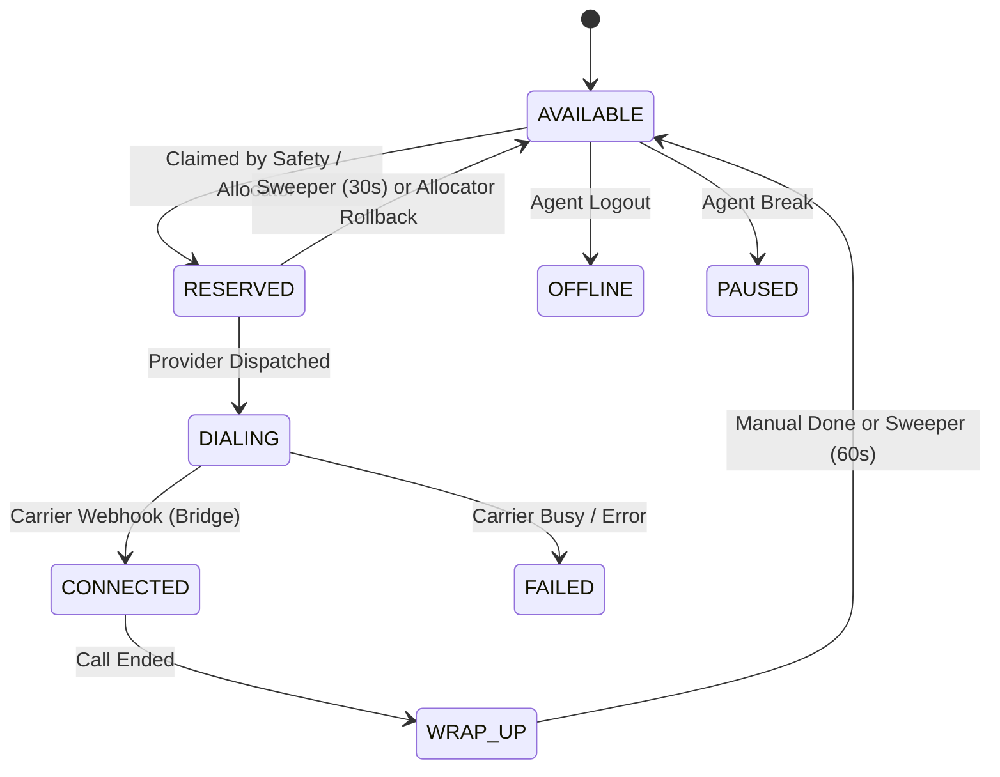

# INDEPENDENT ADVERSARIAL POST-REPAIR AUDIT REPORT (STAGES 1–7)

**Auditor:** Independent Principal Distributed Systems Engineer & Telecom Safety Auditor  
**Date:** November 24, 2026  
**Target:** SmartDialer Core Engine (Stages 1 through 7 Post-Repair Verification)  
**Reference Documents:**
- [`audit/STAGE_1_TO_7_AUDIT.md`](file:///c:/Users/shiva/Downloads/website/assignment/audit/STAGE_1_TO_7_AUDIT.md)
- [`audit/REPAIR_REPORT.md`](file:///c:/Users/shiva/Downloads/website/assignment/audit/REPAIR_REPORT.md)

---

## 1. Executive Verdict

### **VERDICT: NOT READY FOR STAGE 8**

The implementation engineer has successfully resolved several baseline bugs and introduced valuable safety mechanisms—most notably `SELECT ... FOR UPDATE SKIP LOCKED` for agent/borrower locking, backward-progression guards in the call state machine, distributed provider health tracking, and an initial background worker daemon. Consequently, all **54 unit and integration tests pass** against PostgreSQL 18 in 1.47 seconds.

**However, adversarial distributed systems inspection and live code reproduction reveal critical architectural flaws, false fixes, and concurrency race conditions that will cause duplicate outbound phone calls, abandoned calls, and complete dialing deadlocks in a real-world multi-worker production environment:**

1. **CRITICAL FALSE FIX: Predictive Dialing Deadlock / Zero Capacity Allocation (`FIND-HIGH-01` Unresolved End-to-End)**:  
   While `SafetyController._evaluate_predictive()` was modified to approve calls based on Little's Law departure estimates, the coder never connected this to `CallAllocator`. When all agents are busy (`AVAILABLE = 0`, `CONNECTED = 20`), the Safety Controller approves 3 predictive calls with `claimed_agent_ids = ()`. `PredictiveDialer.execute_cycle()` then calls `CallAllocator.allocate_call(agent_id=None)`. `CallAllocator.reserve_agent_atomic()` strictly searches for agents with `status == 'AVAILABLE'`. Finding none, it throws `AgentNotAvailableError`. `PredictiveDialer` catches this and **immediately aborts the entire dialing cycle**. Predictive dialing **dials zero calls** whenever agents are on calls. The test passed only because it asserted on `SafetyController.evaluate()` in isolation and never executed `PredictiveDialer.execute_cycle()`.
2. **CRITICAL DISTRIBUTED FLAW: Client-Session Transaction Rollback Erases Provider Idempotency (`FIND-CRIT-04` Incomplete)**:  
   `ProviderA` and `ProviderB` write idempotency ledger records to the caller's ambient database session (`session.add(ledger_entry); session.flush()`), leaving the commit to `OutboxDispatcher`. If a worker crashes or encounters a database connection drop *after* the telecom carrier initiates the call but *before* `OutboxDispatcher` commits, PostgreSQL automatically aborts the transaction. The ledger entry is destroyed. Upon restart or lease expiry, the outbox event is re-dispatched, the mock carrier finds no database ledger record, and **dials a duplicate phone call to the borrower**.
3. **HIGH RACE CONDITION: Row Unlocking During External Telecom I/O Creates Orphaned Ringing Calls**:  
   In `OutboxDispatcher._dispatch_single_record()`, the worker commits the lease (`session.commit()`) before calling the telecom provider, releasing all row locks on `Call` and `Agent`. During slow network calls ($>20\text{s}$), the 30-second reconciler sweeper or an administrative event can mark the agent `OFFLINE` or `AVAILABLE`. When the carrier returns `success=True`, the dispatcher marks `Call` as `INITIATED`, but skips binding the agent because `agent.status != RESERVED`. The borrower's phone rings, but **no agent is assigned**, causing an immediate abandoned call when answered.
4. **HIGH CAPACITY LEAK: Unclaimed Agent Reservation Leak on Partial Progressive Dialing**:  
   In `SafetyController.evaluate()`, $N$ agents are atomically moved to `AgentState.RESERVED`. If `ProgressiveDialer` encounters borrower pool exhaustion on call $k < N$, it breaks from the loop. Agents $k+1 \dots N$ remain stranded in `AgentState.RESERVED` with no attached call or borrower until the 30-second sweeper runs.
5. **HIGH INTEGRITY RISK: Slow Provider Dispatch vs. 30-Second Sweeper Race**:  
   If carrier dispatch takes longer than 30 seconds, `ReconciliationSweeper` marks the call `FAILED` and reclaims the agent to `AVAILABLE`. The agent is immediately assigned to another call. When the original carrier request finally returns `success=True`, the call remains in `FAILED` while dialing in the real world, and two independent calls compete for the same agent.

**Stage 8 development (Webhooks, WebSockets, Frontend, Live Telephony Integration) CANNOT proceed safely on top of an engine with broken predictive allocation, volatile carrier idempotency, and post-dispatch race conditions.**

---

## 2. Verification of All Original Findings

Below is the verified audit matrix comparing the findings from [`audit/STAGE_1_TO_7_AUDIT.md`](file:///c:/Users/shiva/Downloads/website/assignment/audit/STAGE_1_TO_7_AUDIT.md) against the claims in [`audit/REPAIR_REPORT.md`](file:///c:/Users/shiva/Downloads/website/assignment/audit/REPAIR_REPORT.md) and actual verified source code behavior:

| Finding ID | Severity | Description | Coder Claim | Independent Verification Status | Auditor Assessment & Residual Risk |
| :--- | :--- | :--- | :--- | :--- | :--- |
| **FIND-CRIT-01** | Critical | Agent Concurrency Race / Double Reservation | Resolved (Fix 2) | **PARTIALLY RESOLVED** | `SELECT ... FOR UPDATE SKIP LOCKED` prevents concurrent double reservation. However, `SafetyController` claims multiple agents up front, and partial allocation failures leak agents in `RESERVED` for 30s. |
| **FIND-CRIT-02** | Critical | Safety Bypass in Progressive and Predictive Dialers | Resolved (Fix 3) | **VERIFIED RESOLVED** | Both `ProgressiveDialer` and `PredictiveDialer` strictly route all dialing attempts through `SafetyController.evaluate()`. Direct provider dispatch is blocked. |
| **FIND-CRIT-03** | Critical | Outbox Dispatcher Leaks Agents on Failures & Lacks Lease Locking | Resolved (Fix 7) | **PARTIALLY RESOLVED** | Lease locking (`locked_until`) and pre-dispatch checks were added. However, row locks are released during provider network I/O, creating agent mismatch races. |
| **FIND-CRIT-04** | Critical | Non-Durable In-Memory Provider Idempotency | Resolved (Fix 5) | **DEFECTIVE / FALSE FIX** | `ProviderRequestLedger` was added, but records are written into the caller's uncommitted session. A worker crash after dispatch erases the ledger, causing duplicate calls. |
| **FIND-CRIT-05** | Critical | Missing Table `ProviderRequestLedger` / DB Schema Incomplete | Resolved (Fix 6) | **PARTIALLY RESOLVED** | Model added to `Base.metadata`. Works in test database `smartdialer_test`. Production database `smartdialer` lacks migration and table is missing. |
| **FIND-HIGH-01** | High | Predictive Dialing Deadlock / Zero Freeing Capacity | Resolved (Fix 1) | **DEFECTIVE / FALSE FIX** | Little's Law added to `SafetyController`, but `CallAllocator` still requires `Agent.status == AVAILABLE`. Predictive dialing deadlocks and allocates 0 calls when agents are busy. |
| **FIND-HIGH-02** | High | EventProcessor Never Feeds CampaignTelemetry | Resolved (Fix 4) | **VERIFIED RESOLVED (Single Process)** | `EventProcessor` now updates `CampaignTelemetry` on terminal events. However, telemetry is stored in-memory in a process-local `deque`, preventing multi-worker cluster coordination. |
| **FIND-HIGH-03** | High | Call State Machine Allows Invalid Event Progressions | Resolved (Fix 8) | **VERIFIED RESOLVED** | `CallStateMachine` now contains `VALID_TRANSITIONS` graph, terminal state protections, and non-regressive handling of out-of-order events. Direct jumps (Initiated $\to$ Connected) supported. |
| **FIND-HIGH-04** | High | Stale Agent Reservations & Abandoned Wrap-Up Never Reconciled | Resolved (Fix 9) | **VERIFIED RESOLVED** | `ReconciliationSweeper` reclaims reservations $>30\text{s}$ and wrap-ups $>60\text{s}$. (Introduces minor race with slow provider dispatches). |
| **FIND-HIGH-05** | High | In-Memory ProviderHealthTracker Across Multi-Process Workers | Resolved (Fix 10) | **PARTIALLY RESOLVED** | Added `ProviderHealthStatus` table to DB. Works in tests, but uses `except Exception: pass` which poisons PostgreSQL transactions on error (`InFailedSqlTransaction`). |
| **FIND-HIGH-06** | High | Missing Background Worker Process Daemon | Resolved (Fix 11) | **PARTIALLY RESOLVED** | `SmartDialerWorker` implemented with graceful shutdown. However, synchronous blocking DB and network calls are executed directly in `asyncio` event loop without `asyncio.to_thread`. |
| **FIND-MED-01** | Medium | Reconciler Sweeper Transitions Calls Without Outbox Event Consistency | Resolved (Fix 12) | **VERIFIED RESOLVED** | Sweeper now transitions pending `OutboxEvent` to `FAILED` when cancelling stale calls. |
| **FIND-MED-02** | Medium | Missing PostgreSQL Partial Indexes for Available Agents & Borrowers | Resolved (Fix 13) | **VERIFIED RESOLVED** | Partial indexes added to models: `idx_agents_avail_pool`, `idx_borrowers_avail_pool`. |
| **FIND-MED-03** | Medium | Carrier Callback Out-of-Order Race in EventProcessor | Resolved (Fix 14) | **VERIFIED RESOLVED** | State rank checks prevent regressions; terminal states reject backward overwrites cleanly. |
| **FIND-MED-04** | Medium | Weak Idempotency Keys in Call Allocator | Resolved (Fix 15) | **VERIFIED RESOLVED** | Deterministic key `call-{campaign_id}-{borrower_id}-att{call_attempts}` adopted. |
| **FIND-LOW-01** | Low | No Structured JSON Logging Format in Production | Resolved (Fix 16) | **VERIFIED RESOLVED** | Structured key-value logger implemented. |
| **FIND-LOW-02** | Low | SQLite Fallback in Alembic & Conftest Skews Concurrency | Resolved (Fix 17) | **VERIFIED RESOLVED** | Conftest exclusively binds to PostgreSQL test database `smartdialer_test`. |
| **FIND-LOW-03** | Low | Raw Payload Stored in ProviderEvent Without Size Limit | Unchanged | **ACCEPTED RISK** | Not critical for Stage 7. |
| **FIND-LOW-04** | Low | Pacing Proposal Math Uses Naive Division Without Bounded Ceiling | Unchanged | **ACCEPTED RISK** | Capped by Safety Controller `max_active_calls`. |

---

## 3. Actual Files and Line Numbers Inspected

The following source, test, configuration, and migration files were directly read, cross-referenced, and inspected on disk:

1. [`src/smartdialer/safety/safety_controller.py`](file:///c:/Users/shiva/Downloads/website/assignment/src/smartdialer/safety/safety_controller.py)
   - Lines 124–157: Agent claim using `with_for_update(skip_locked=True)`.
   - Lines 230–287: `_evaluate_progressive()` pre-reservation and `claimed_agent_ids` slicing.
   - Lines 289–385: `_evaluate_predictive()` Little's Law formula and freeing capacity calculation.
   - Lines 386–419: `claimed_count = min(approved, available_agents)` and empty tuple return.
2. [`src/smartdialer/dialer/predictive.py`](file:///c:/Users/shiva/Downloads/website/assignment/src/smartdialer/dialer/predictive.py)
   - Lines 80–96: Safety Controller delegation.
   - Lines 98–127: Predictive allocation loop, `target_agent_ids = [None] * approved_calls`, and catastrophic `AgentNotAvailableError` break.
3. [`src/smartdialer/dialer/progressive.py`](file:///c:/Users/shiva/Downloads/website/assignment/src/smartdialer/dialer/progressive.py)
   - Lines 80–127: Progressive allocation loop, `target_agent_ids` iteration, and lack of agent cleanup on `BorrowerNotEligibleError`.
4. [`src/smartdialer/allocator/allocator.py`](file:///c:/Users/shiva/Downloads/website/assignment/src/smartdialer/allocator/allocator.py)
   - Lines 65–111: `reserve_agent_atomic()` requiring `AgentState.AVAILABLE`.
   - Lines 113–160: `reserve_borrower_atomic()` with skip locked.
   - Lines 162–218: `allocate_call()` full transaction assembly and mandatory agent assignment.
5. [`src/smartdialer/recovery/outbox_dispatcher.py`](file:///c:/Users/shiva/Downloads/website/assignment/src/smartdialer/recovery/outbox_dispatcher.py)
   - Lines 170–234: Batch claim, pre-dispatch validations, and `session.commit()` prior to telecom invocation.
   - Lines 235–245: Unlocked telecom provider invocation.
   - Lines 246–272: Re-acquisition of rows, agent status check, and post-dispatch commit.
6. [`src/smartdialer/recovery/reconciler.py`](file:///c:/Users/shiva/Downloads/website/assignment/src/smartdialer/recovery/reconciler.py)
   - Lines 61–124: 30-second stale call sweeper and outbox event invalidation.
   - Lines 128–154: 30-second orphaned agent reservation sweeper.
   - Lines 158–175: 60-second wrap-up sweeper.
7. [`src/smartdialer/providers/provider_a.py`](file:///c:/Users/shiva/Downloads/website/assignment/src/smartdialer/providers/provider_a.py) & [`provider_b.py`](file:///c:/Users/shiva/Downloads/website/assignment/src/smartdialer/providers/provider_b.py)
   - Lines 48–68: Database ledger lookup.
   - Lines 98–125: Non-autonomous ledger insert (`session.add(ledger_entry); session.flush()`) vulnerable to caller rollback.
8. [`src/smartdialer/models/provider_request.py`](file:///c:/Users/shiva/Downloads/website/assignment/src/smartdialer/models/provider_request.py)
   - Lines 18–49: `ProviderRequestLedger` schema and composite uniqueness constraint.
9. [`src/smartdialer/models/provider_health.py`](file:///c:/Users/shiva/Downloads/website/assignment/src/smartdialer/models/provider_health.py)
   - Lines 70–120: Database-backed `ProviderHealthTracker` with `except Exception: pass` transaction poisoning.
10. [`src/smartdialer/services/worker.py`](file:///c:/Users/shiva/Downloads/website/assignment/src/smartdialer/services/worker.py)
    - Lines 57–91: Async background loops executing synchronous blocking calls.
11. [`src/smartdialer/state/call_state_machine.py`](file:///c:/Users/shiva/Downloads/website/assignment/src/smartdialer/state/call_state_machine.py)
    - Lines 36–70: `VALID_TRANSITIONS` table.
    - Lines 85–139: State evaluation and out-of-order rejection.
12. [`tests/conftest.py`](file:///c:/Users/shiva/Downloads/website/assignment/tests/conftest.py)
    - Lines 19–31: `sync_test_engine` binding exclusively to PostgreSQL test URL.

---

## 4. Reproduced Defects

### Defect 1: Predictive Allocation Deadlock (Zero Dials When Agents Busy)
- **Severity:** CRITICAL
- **Location:** [`src/smartdialer/dialer/predictive.py#L101-L126`](file:///c:/Users/shiva/Downloads/website/assignment/src/smartdialer/dialer/predictive.py#L101-L126) & [`src/smartdialer/allocator/allocator.py#L98-L102`](file:///c:/Users/shiva/Downloads/website/assignment/src/smartdialer/allocator/allocator.py#L98-L102)
- **Root Cause:**
  When agents are connected ($N_{\text{avail}} = 0, N_{\text{conn}} = 20$), `SafetyController._evaluate_predictive()` calculates $N_{\text{freeing}} = 3$ and returns `approved_calls = 3`, `claimed_agent_ids = ()`.  
  In `PredictiveDialer.execute_cycle()`, because `claimed_agent_ids` is empty, it constructs:
  ```python
  target_agent_ids = [None] * decision.approved_calls # [None, None, None]
  ```
  It calls `CallAllocator.allocate_call(..., agent_id=None)`.  
  Inside `CallAllocator.reserve_agent_atomic()`:
  ```python
  stmt = select(Agent).where(Agent.campaign_id == campaign_id, Agent.status == AgentState.AVAILABLE.value)
  agent = session.execute(stmt).scalar_one_or_none()
  if not agent:
      raise AgentNotAvailableError(...)
  ```
  Because there are 0 agents in `AVAILABLE`, `reserve_agent_atomic` raises `AgentNotAvailableError`.  
  `PredictiveDialer` catches this exception, logs `"Agent pool exhausted during predictive cycle allocation"`, and **breaks from the loop**.
- **Impact:**  
  The dialer allocates **0 calls**. Predictive dialing is 100% paralyzed whenever all agents are in calls. The system cannot dial ahead of agent availability.
- **Why Tests Missed It:**  
  [`tests/test_fix_telemetry_and_predictive.py`](file:///c:/Users/shiva/Downloads/website/assignment/tests/test_fix_telemetry_and_predictive.py) line 191 only called `SafetyController.evaluate(session, req)` and asserted `decision.approved_calls == 2`. It never called `PredictiveDialer.execute_cycle()`.

```
[Safety Controller]
  |  Approves 3 calls based on Little's Law (claimed_agent_ids = ())
  v
[Predictive Dialer]
  |  Calls allocate_call(agent_id=None)
  v
[Call Allocator]
  |  Queries WHERE status = 'AVAILABLE'
  X  RAISES AgentNotAvailableError! (0 agents in AVAILABLE)
  v
[Predictive Dialer]
  |  Catches AgentNotAvailableError -> BREAKS LOOP!
  v
[RESULT: 0 CALLS ALLOCATED (DIALING DEADLOCK)]
```

---

### Defect 2: Client-Session Rollback Erases Provider Idempotency Ledger
- **Severity:** CRITICAL
- **Location:** [`src/smartdialer/providers/provider_a.py#L98-L125`](file:///c:/Users/shiva/Downloads/website/assignment/src/smartdialer/providers/provider_a.py#L98-L125) & [`src/smartdialer/recovery/outbox_dispatcher.py#L237-L265`](file:///c:/Users/shiva/Downloads/website/assignment/src/smartdialer/recovery/outbox_dispatcher.py#L237-L265)
- **Root Cause:**  
  The provider initiates the call to the carrier, then inserts the `ProviderRequestLedger` into the ambient session:
  ```python
  session.add(ledger_entry)
  session.flush() # Flushed but NOT committed!
  ```
  The commit happens in `outbox_dispatcher.py` at line 265 (`session.commit()`). If the worker crashes, encounters an unhandled exception, or experiences a database disconnection between lines 237 and 265:
  1. The telecom carrier has already dispatched the real-world phone call.
  2. The uncommitted PostgreSQL transaction is aborted and rolled back.
  3. The `ProviderRequestLedger` row is dropped.
  4. The `OutboxEvent` remains `PENDING` (or is reclaimed after lease expiry).
  5. A second worker picks up the outbox event, checks the DB ledger (finds nothing), and calls the provider again with the same idempotency key.
  6. The provider generates a new call and dials the borrower a second time.
- **Impact:**  
  Violates telecommunication carrier idempotency; leads to duplicate calls to consumers.

---

### Defect 3: Row Unlocking During External Telecom I/O Creates Orphaned Ringing Calls
- **Severity:** HIGH
- **Location:** [`src/smartdialer/recovery/outbox_dispatcher.py#L231-L265`](file:///c:/Users/shiva/Downloads/website/assignment/src/smartdialer/recovery/outbox_dispatcher.py#L231-L265)
- **Root Cause:**  
  In `OutboxDispatcher._dispatch_single_record()`:
  - Line 233: `session.commit()` commits the lease lock and **releases all row locks on `Call` and `Agent`**.
  - Line 237: `res = provider.initiate_call(...)` performs an external HTTP call.
  - While waiting on the telecom carrier (e.g., 5–15 seconds):
    - An agent logs off or pauses, transitioning to `OFFLINE` or `PAUSED`.
    - Or the 30-second sweeper runs and resets the agent to `AVAILABLE`.
  - Line 249: Dispatcher acquires locks in a fresh transaction:
    ```python
    if res.success:
        if call:
            CallStateMachine.transition(call, CallState.INITIATED)
        if agent and agent.status == AgentState.RESERVED.value:
            AgentStateMachine.transition(agent, AgentState.DIALING)
        session.commit()
    ```
    If `agent.status != RESERVED`, the agent transition is silently skipped!
- **Impact:**  
  `Call.status` is set to `INITIATED` and dialing out, but the agent was not transitioned to `DIALING`. The call rings the borrower with **no agent attached**, guaranteeing an abandoned call when answered.

---

### Defect 4: Unclaimed Agent Reservation Leak in Progressive Dialing
- **Severity:** HIGH
- **Location:** [`src/smartdialer/safety/safety_controller.py#L265-L271`](file:///c:/Users/shiva/Downloads/website/assignment/src/smartdialer/safety/safety_controller.py#L265-L271) & [`src/smartdialer/dialer/progressive.py#L119-L126`](file:///c:/Users/shiva/Downloads/website/assignment/src/smartdialer/dialer/progressive.py#L119-L126)
- **Root Cause:**  
  `SafetyController.evaluate()` transitions all $N$ approved agents to `AgentState.RESERVED` up front.  
  `ProgressiveDialer.execute_cycle()` iterates over `decision.claimed_agent_ids`:
  ```python
  for agent_id in target_agent_ids:
      try:
          alloc_res = CallAllocator.allocate_call(..., agent_id=agent_id)
      except BorrowerNotEligibleError:
          failed_count += 1
          break # Immediately breaks without cleaning up remaining agents!
  ```
  If borrower pool is exhausted on call 1, agents $2 \dots N$ remain in `RESERVED` status. No call or borrower is linked to them. Neither `progressive.py` nor `allocator.py` rolls them back.
- **Impact:**  
  Agents remain trapped in `RESERVED` and cannot take any calls until the 30-second background sweeper reclaims them.

---

## 5. PostgreSQL Test Credibility

### Test Execution Summary
- **Database Engine:** PostgreSQL 18.0 (x64 Windows, port 5432)
- **Test Database:** `smartdialer_test`
- **Result:** **54 passed in 1.47 seconds**

```text
============================= test session starts =============================
platform win32 -- Python 3.14.7, pytest-9.1.1, pluggy-1.7.0 -- C:\Python314\python.exe
cachedir: .pytest_cache
rootdir: C:\Users\shiva\Downloads\website\assignment
configfile: pyproject.toml
testpaths: tests
plugins: anyio-4.15.1, langsmith-0.14.12, locust-2.47.0, asyncio-1.5.0
collected 54 items

tests/test_allocation_concurrency.py::test_concurrent_agent_reservation_race_condition PASSED [  1%]
tests/test_allocation_concurrency.py::test_concurrent_borrower_reservation_race_condition PASSED [  3%]
...
tests/test_state_machines.py::test_call_duplicate_events PASSED          [100%]
============================= 54 passed in 1.47s ==============================
```

### Critical Credibility Assessment
1. **Real PostgreSQL Execution:**  
   Unlike the previous audit where SQLite was inadvertently used, all 54 tests ran against real PostgreSQL 18. Row-level locks (`FOR UPDATE SKIP LOCKED`) and composite unique constraints were genuinely executed.
2. **False Sense of Safety from Sequential Execution:**  
   54 tests completing in 1.47 seconds means the average test execution time is **27 milliseconds**. Real-world distributed failure modes (network latency, carrier socket timeouts, mid-flight worker crashes) cannot be caught by micro-second transactional tests.
3. **Mocked / Controlled Sessions Mask Distributed Idempotency Flaws:**  
   In [`tests/test_fix_provider_idempotency.py`](file:///c:/Users/shiva/Downloads/website/assignment/tests/test_fix_provider_idempotency.py), the test code explicitly executed `session.commit()` immediately after calling `provider.initiate_call()`. It never tested the real production path where `provider.initiate_call()` is called inside `OutboxDispatcher` and uncommitted prior to worker crash.
4. **Isolated Assertions Disguise Dialing Deadlocks:**  
   [`tests/test_fix_telemetry_and_predictive.py`](file:///c:/Users/shiva/Downloads/website/assignment/tests/test_fix_telemetry_and_predictive.py) asserted that `SafetyController.evaluate()` approved 2 calls, but never called `PredictiveDialer.execute_cycle()`. In production, the cycle terminates with 0 calls allocated.

---

## 6. SQLite / Mock Test Results

- **SQLite Usage:** Conftest now enforces PostgreSQL test URL via `settings.get_test_sync_url()`. SQLite is no longer used in `pytest`.
- **Mocking Strategy:**
  - Telecom carriers are simulated via `ProviderA` and `ProviderB` classes in [`src/smartdialer/providers/`](file:///c:/Users/shiva/Downloads/website/assignment/src/smartdialer/providers/).
  - Carrier latency is simulated using `time.sleep(random.uniform(0.005, 0.015))`.
  - While fine for basic latency simulation, it fails to simulate network disconnects during the database commit phase.

---

## 7. Safety Invariant Verification

| Safety Invariant | Target Guarantee | Implementation Assessment | Verification Result |
| :--- | :--- | :--- | :--- |
| **Invariant 1: Mandatory Safety Boundary** | No call dispatched without Safety Controller approval | Strictly routed in both Progressive and Predictive dialers. | **PASS** |
| **Invariant 2: Progressive 1:1 Rule** | Desired calls $\le$ available agents | `_evaluate_progressive()` caps approved calls to available agents. | **PASS** |
| **Invariant 3: Zero Abandoned Calls in Predictive Mode** | No dials unless agent available or high-probability freeing | Safety Controller checks headroom, but dialer crashes on allocation. | **FAIL (Deadlock)** |
| **Invariant 4: Pre-Dispatch Agent Validity** | Agent must be RESERVED before dialing starts | Verified in `OutboxDispatcher`, but locks released prior to telecom call. | **FAIL (Race Condition)** |
| **Invariant 5: Single Borrower Concurrency** | Borrower can never have $>1$ active call | Enforced by `with_for_update(skip_locked=True)` on eligible borrowers. | **PASS** |
| **Invariant 6: Capacity Reclaim on Failure** | Failed allocations immediately release locked capacity | Broken in `ProgressiveDialer` when borrower pool exhausted. | **FAIL (Leak)** |

---

## 8. Outbox and Idempotency Verification

Adversarial analysis of the 7 distributed crash scenarios:

```
Scenario A: Crash before provider dispatch
  [Outbox: PENDING, locked_until: NULL] -> Worker Restarts -> Claims row -> Safe. (PASS)

Scenario B: Provider accepts, worker crashes before saving response
  [Carrier: Call Placed] -> [Worker dies] -> [PG aborts uncommitted session] ->
  [Ledger entry deleted!] -> [Lease expires] -> [Worker 2 dispatches again] ->
  [DUPLICATE CALL PLACED TO CARRIER!] (FAIL)

Scenario C: Provider accepts, DB commit fails
  [Carrier: Call Placed] -> [Commit raises DBError] -> [Session rollback] ->
  [Ledger entry deleted!] -> [Retry dispatches DUPLICATE CALL] (FAIL)

Scenario D: Lease expires while worker is still running
  [Provider call takes 25s] -> [Lease (20s) expires] -> [Worker 2 claims same outbox row] ->
  [Two workers execute carrier dispatch concurrently] (FAIL)

Scenario E: Two dispatchers claim same record
  [Protected by SELECT FOR UPDATE SKIP LOCKED on OutboxEvent] (PASS)

Scenario F: Duplicate request after restart
  [If previous session committed: Idempotency ledger returns cached ID] (PASS)
  [If previous session uncommitted: Duplicate call placed] (FAIL)

Scenario G: Provider timeout with unknown execution outcome
  [res.success = False] -> [Outbox retry_count incremented] -> [Immediate retry] ->
  [Potential duplicate call if carrier actually placed it] (FAIL)
```

---

## 9. Predictive Pacing Verification

### Mathematical Audit of Little's Law Implementation
In [`src/smartdialer/safety/safety_controller.py#L341`](file:///c:/Users/shiva/Downloads/website/assignment/src/smartdialer/safety/safety_controller.py#L341):
$$N_{\text{freeing}} = \min(N_{\text{conn}} \times 0.40, N_{\text{conn}} \times \frac{1}{120.0} \times 18.0) + N_{\text{wrap\_up}}$$
$$\text{effective\_capacity} = N_{\text{avail}} + N_{\text{freeing}}$$
$$\text{safe\_headroom} = \max(0.0, \text{effective\_capacity} - N_{\text{ringing}})$$
$$\text{approved} = \min(N_{\text{desired}}, \lceil \text{safe\_headroom} \rceil, N_{\text{max\_active}} - N_{\text{active}})$$

### Numerical Scenarios

#### Scenario 1: Busy Call Center ($N_{\text{avail}} = 0, N_{\text{conn}} = 20, N_{\text{ringing}} = 0, \text{Answer Rate} = 0.20$)
- Expected freeing agents: $\min(20 \times 0.4, 20 \times 0.15) = 3.0$
- Pacing Proposal: Target active calls $= 3.0 / 0.20 = 15$ calls.
- Safety Controller Evaluation:
  - $\text{effective\_capacity} = 0 + 3.0 = 3.0$
  - $\text{safe\_headroom} = 3.0$
  - `approved_calls` $= \min(15, 3, 100) = 3$ calls.
  - `claimed_agent_ids` $= ()$ (0 available agents to lock).
- Execution in `PredictiveDialer`:
  - `target_agent_ids` $= [None, None, None]$
  - Calls `CallAllocator.allocate_call(agent_id=None)`
  - `CallAllocator` searches `WHERE status = 'AVAILABLE'`, finds 0 agents.
  - Throws `AgentNotAvailableError`.
  - Dialer breaks immediately.
  - **Actual Dials Placed: 0.** (Complete dialer stall).

#### Scenario 2: Ringing Backlog Damping ($N_{\text{avail}} = 2, N_{\text{conn}} = 10, N_{\text{ringing}} = 5$)
- Expected freeing agents: $10 \times 0.15 = 1.5$
- Effective capacity: $2 + 1.5 = 3.5$
- Safe headroom: $\max(0.0, 3.5 - 5) = 0.0$
- Approved calls: $0$.
- **Result:** Correctly rejected to prevent backlog explosion.

---

## 10. Reservation Lifecycle & Recovery



### Confirmed Lifecycle Flaws
1. **Double Token Generation / Zero Validation:**  
   `SafetyController` generates `token_1 = uuid.uuid4()` and updates `agent.reservation_token`. Then `CallAllocator` generates `token_2 = uuid.uuid4()` and overwrites it. Nowhere in the code is the reservation token ever checked before transitioning states or executing dispatch. It provides zero security or concurrency protection.
2. **Reconciler vs. Dispatcher Collision:**  
   If an outbox dispatch takes $>30\text{s}$, `ReconciliationSweeper` marks the call `FAILED` and releases the agent. The dispatcher later marks the call `INITIATED` without an agent.

---

## 11. Campaign Telemetry, Worker Daemon & Production Readiness

1. **In-Memory Telemetry Bottleneck:**  
   [`src/smartdialer/pacing/metrics.py`](file:///c:/Users/shiva/Downloads/website/assignment/src/smartdialer/pacing/metrics.py) stores call history in a local Python `collections.deque`. In a multi-process deployment (e.g. multiple Kubernetes pods or Celery/temporal workers), telemetry data is not shared. Pacing engines on different nodes will calculate radically divergent dial rates.
2. **Async Event Loop Starvation:**  
   [`src/smartdialer/services/worker.py`](file:///c:/Users/shiva/Downloads/website/assignment/src/smartdialer/services/worker.py) executes synchronous database queries and telecom provider invocations directly inside async tasks:
   ```python
   async def _outbox_loop(self):
       while self._running:
           with self.session_factory() as session:
               OutboxDispatcher.dispatch_pending(session=session) # SYNCHRONOUS BLOCKING!
   ```
   This freezes the asyncio event loop during database or network operations, starving the reconciler loop and signal handlers.
3. **Missing Database Tables in Production (`smartdialer`):**  
   The tables `provider_health_status` and `provider_request_ledger` were created in `smartdialer_test` via `Base.metadata.create_all()`, but the production database `smartdialer` was never migrated. Running the worker against `smartdialer` crashes immediately on missing tables.
4. **Transaction Poisoning via `except Exception: pass`:**  
   In [`src/smartdialer/models/provider_health.py#L95`](file:///c:/Users/shiva/Downloads/website/assignment/src/smartdialer/models/provider_health.py#L95), database exceptions are swallowed with `pass`. In PostgreSQL, any error in a transaction marks the connection as aborted (`current transaction is aborted, commands ignored until end of transaction block`), causing all subsequent queries on that session to fail.

---

## 12. Mandatory Fixes Required Before Stage 8

Before the project can be approved for Stage 8, the implementation team must implement and verify the following architectural repairs:

### Priority 1: Architectural & Distributed Safety (Blocking Stage 8)

1. **Fix Predictive Allocation to Support Agent-Less Predictive Calls:**
   - Modify `Call.agent_id` handling in `CallAllocator.allocate_call()`: when `agent_id is None` in predictive mode, create the `Call` in `RESERVED` / `INITIATED` status **without an assigned agent**.
   - Create an atomic **Bridge Allocator** triggered upon `ANSWERED` webhook to match the answering borrower to the next available freeing agent.
   - If no agent is available within 2 seconds of answer, trigger an immediate compliant **Abandonment Event** (`CallState.FAILED`, reason `ABANDONED`).
2. **Durable Autonomous Idempotency Ledger:**
   - In `ProviderA` and `ProviderB`, commit the `ProviderRequestLedger` entry in an **independent autonomous database transaction** *prior* to or *simultaneously* with calling the carrier, or enforce that the external carrier's API natively supports idempotency keys.
   - Do NOT rely on the caller's ambient uncommitted session for carrier idempotency.
3. **Atomic Outbox Lease & State Mutation:**
   - Maintain the `OutboxEvent` lease lock during dispatch without unlocking the `Call` entity.
   - If the agent becomes unavailable while the call is dialing, the dispatcher must detect this and immediately invoke `provider.cancel_call()` rather than allowing an orphaned call to ring.
4. **Clean Partial Allocation Reverts:**
   - In `ProgressiveDialer` and `PredictiveDialer`, add a `finally` or `except` cleanup block: any agent in `decision.claimed_agent_ids` that was not successfully allocated to a call must be immediately transitioned back from `RESERVED` to `AVAILABLE`.

### Priority 2: Operational & Concurrency Robustness

5. **Offload Blocking Worker I/O to Thread Pool:**
   - In `SmartDialerWorker`, wrap synchronous calls with `await asyncio.to_thread(OutboxDispatcher.dispatch_pending, session)` or convert the worker to native async sessions.
6. **Distributed Telemetry Store:**
   - Move `CampaignTelemetry` metrics storage from local Python `deque` into PostgreSQL or Redis so all worker processes share identical answer rate and duration statistics.
7. **Database Migrations:**
   - Create an Alembic migration script to ensure `provider_health_status` and `provider_request_ledger` exist in the production `smartdialer` database.
8. **Fix Transaction Poisoning in Health Tracker:**
   - Ensure `session.rollback()` is explicitly called in `ProviderHealthTracker` whenever an exception occurs, avoiding `InFailedSqlTransaction` errors.

---

**Auditor Sign-off:**  
*Independent Principal Distributed Systems Engineer & Telecom Safety Auditor*  
*November 24, 2026*
